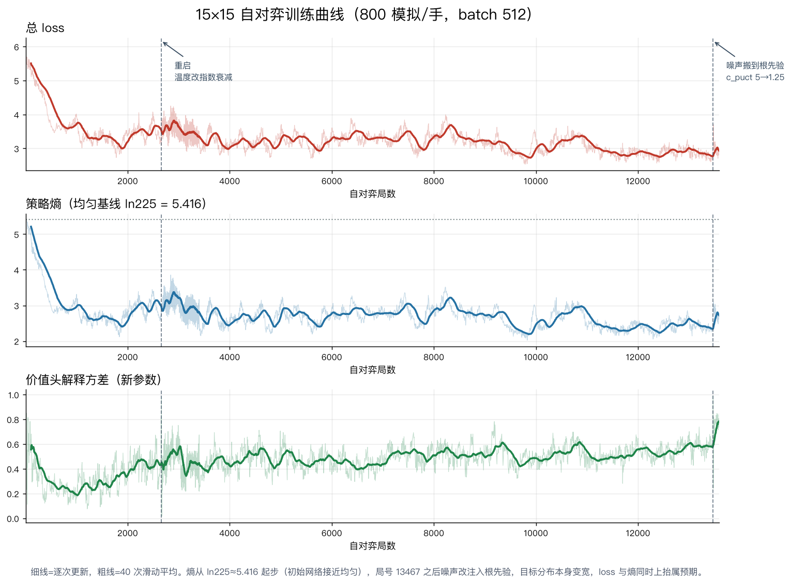
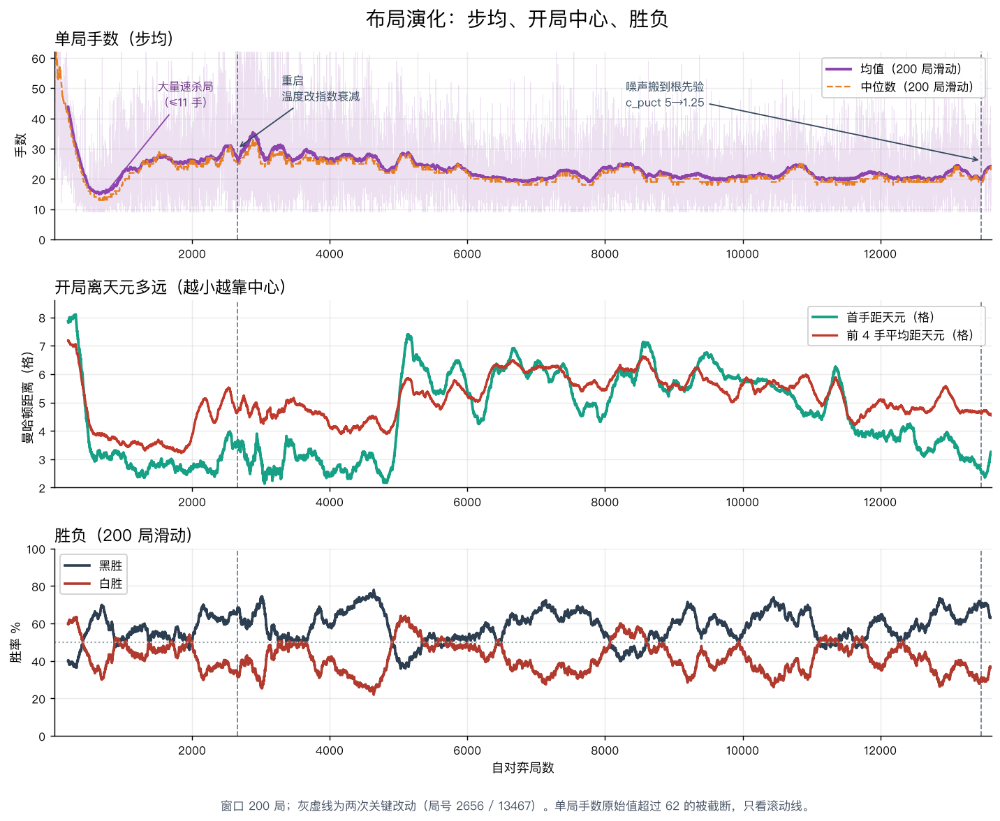
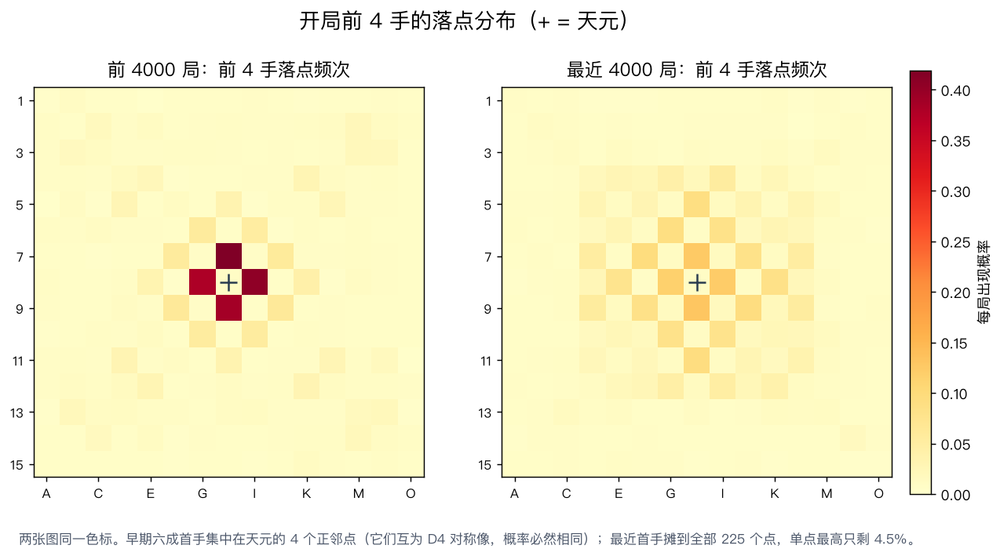
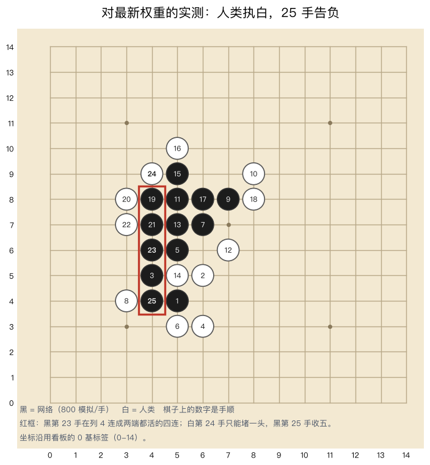

# AlphaZero Gomoku 15×15

在 [junxiaosong/AlphaZero_Gomoku](https://github.com/junxiaosong/AlphaZero_Gomoku) 基础上改的 15×15 五子棋（连五）AlphaZero 训练实现。单机 Apple Silicon CPU 跑，1 个训练进程 + 8 个自对弈工兵，带一个本地 Web 看板。

原版是 6×6 / 8×8 的教学实现：单进程、3 层卷积、几小时出模型。把棋盘推到 15×15 之后这些都不够用了，所以网络、并行结构、评估工具基本重做了一遍。

## 目录

- [网络](#网络)
- [训练策略](#训练策略)
- [训练设备](#训练设备)
- [产出效率](#产出效率)
- [训练曲线](#训练曲线)
- [布局演化](#布局演化)
- [关键调整](#关键调整)
- [人类对局实测](#人类对局实测)
- [跑起来](#跑起来)
- [已知问题](#已知问题)

## 网络

8 个残差块 × 128 通道，总计 **2,501,226 个参数**，权重文件 9.6 MB。CPU 上 float32 直接推理，不做量化。

| 模块 | 结构 | 参数 |
|---|---|---|
| 输入卷积 | 4→128，3×3，无 bias + BN | 4,608 + 256 |
| 残差主干 | 8 × [conv3×3→BN→ReLU→conv3×3→BN→add→ReLU] | 2,363,392 |
| 策略头 | conv3×3→1 + conv1×1→1 → concat(2×15×15) → FC(450→225) → log_softmax | 1,376 + 101,475 |
| 价值头 | conv3×3→1 → flatten(225) → FC(225→128) → ReLU → FC(128→1) → tanh | 1,282 + 28,928 + 129 |

输入是 4 个特征平面（`game.py:current_state`）：

```
ch0  当前走子方的棋子
ch1  对手的棋子
ch2  最后一手的位置
ch3  执黑常量（轮到黑走时全 1）
```

最后整盘再做一次垂直翻转 `[:, ::-1, :]` 才喂给网络。这个翻转只影响网络看到的坐标，训练标签仍然是真实坐标 —— 这条有历史包袱，`tools/probe_policy_frame.py` 里量过：翻回来读的话 top-1 命中 6.6%，不翻 32.1%。

## 训练策略

| 项 | 值 |
|---|---|
| 每手模拟数 | 800（固定，全程不变）|
| MCTS 常数 | `c_puct = 1.25`，无 FPU 项 |
| 根节点噪声 | Dirichlet ε=0.25，α=0.03，**注入根子节点先验**，每手一次、800 次模拟共享 |
| 落子温度 | 前 4 手 1.0，之后 `exp(-(n-4)/8)`，地板 0.05 |
| policy 标签 | 访问数归一化，**不含温度**（温度只影响怎么选，不影响学什么）|
| value 标签 | 终局胜负 ±1 |
| 优化器 | Adam，基准 lr 2e-3，按 KL 自适应倍率（`kl_targ = 0.02`）|
| 每批训练 | 512 样本 × 5 epochs |
| 经验回放 | 10000 条（8 倍对称增强之后），滚动窗口 |
| 数据增强 | 每局入库时展开 8 个 D4 对称 |
| 权重发布 | 每 40 局一版，工兵看到版本号才重载 |
| 检查点 | 每 50 局一存 |

自对弈规模：8 个工兵进程，各自独立随机流，打同一版权重，落盘成 `queue/*.npz`；主进程收齐后更新一次网络，再把新权重发回去。

### 关于探索噪声的位置

原版把 Dirichlet 噪声加在 MCTS **结束之后**的落子抽样上（类似 ε-greedy），树里的先验不加噪。作者在 [#73](https://github.com/junxiaosong/AlphaZero_Gomoku/issues/73) 里说明过：他知道论文写法、也试过，在小棋盘小算力下没观察到提升，所以选了这种更简单的做法。

这里改回论文写法：每手把噪声注入根节点的子节点先验，之后 800 次模拟都在这份加噪先验下搜，落子从访问分布里采样 —— 落子和训练标签来自同一次搜索。

差别可以自己量（`tools/probe_noise_position.py`，同一权重同一开局，200 sim × 10 手）：

| | 落子点访问数为 0 的手数 | 落子点按访问数排名中位数 | 落子点 π 中位数 |
|---|---|---|---|
| 噪声混落子抽样 | 4 / 10 | 90 | 0.004 |
| 噪声进根先验 | 0 / 10 | 2 | 0.085 |

只有一局 10 手，样本很小。但「四分之一的落子落在搜索完全没访问过的点」这个比例和 ε=0.25 是对得上的：噪声把落子拽进了没分析过的局面。

顺带把 `c_puct` 从原版的 5 调到 1.25（5 意味着几乎完全跟着网络先验走，800 次模拟的纠错基本用不上）。两条都有开关，`--root_noise 0` / `--c_puct 5` 可以复现旧行为。

## 训练设备

| | |
|---|---|
| 机器 | Apple Mac mini（Apple M4）|
| CPU | 10 核，4 性能核 + 6 能效核 |
| 内存 | 16 GB 统一内存 |
| 系统 | macOS 26.4 |
| 框架 | PyTorch 2.15，CPU 后端（`torch.cuda.is_available() = False`）|

这台机器有 MPS，但训练和自对弈都跑在 CPU 上：MCTS 是一条一条串行的，单次前向只有一张 15×15×4 的小图，MPS 的调度开销比算力收益大。

8 个工兵正好铺满 8 个核（4 性能核 + 4 能效核）。训练进程和看板抢剩下的核，所以网络更新的频率比自对弈低一个量级 —— 瓶颈在自对弈，不在梯度。

## 产出效率

累计 87.2 小时、14386 局自对弈。全程平均 **165 局/小时**，但局数和手数都在变，分段看更准：

| 阶段 | 局数 | 耗时 | 局/小时 | 原始样本/小时 | 单局耗时 | 均手 |
|---|---|---|---|---|---|---|
| 起点 → 局号 2656 | 2654 | 16.8 h | 158 | 4040 | 183 s | 25.6 |
| 2656 → 13467 | 11561 | 68.6 h | 168 | 3931 | 171 s | 23.3 |
| 13467 → 现在 | 168 | 1.8 h | 96 | 2448 | 289 s | 25.5 |

单工兵每秒约 100 次网络前向（800 模拟 × 20 手 / 160 秒），8 个工兵合计约 800 次/秒。最后一段降到约 79 次/秒、合计 636 次/秒，原因是噪声改到根先验后对局变长，而每次 MCTS 模拟都要 `copy.deepcopy(board)`，局越长这份拷贝越贵。

代价与收益：局数产出掉 43%，但样本产出只掉 38%（每局手数变长），换来的是落子不再落到搜索没看过的地方。

## 训练曲线



从上到下：总 loss、策略熵、价值头解释方差。细线是每次网络更新的原始值，粗线是 40 次滑动平均，灰虚线是两次关键改动。

- **熵**从 ln225 ≈ 5.416 起步（初始网络接近均匀分布），一路降到 2.3 附近，说明策略在收敛。
- 局号 13467 之后熵和 loss 同时上抬，这是**预期**的：策略标签从「搜索从不探索的尖锐分布」变成「带噪探索出的较宽分布」，目标本身变难了，不是学坏了。
- **解释方差**从 0.05 爬到 0.6~0.8，价值头确实在学终局结果。

## 布局演化



三块面板：单局手数、开局离天元多远、黑白胜率，都是 200 局滑动窗口。

按阶段取平均：

| 阶段 | 局数 | 均手 | 中位 | ≤11 手速杀 | 黑胜 | 白胜 | 首手距天元 | 前 4 手距天元 |
|---|---|---|---|---|---|---|---|---|
| 起点 → 2656 | 2655 | 25.6 | 23 | 11.6% | 56.1% | 43.9% | 3.53 | 4.35 |
| 2656 → 13467 | 11562 | 23.3 | 22 | 10.1% | 58.7% | 41.3% | 4.61 | 5.25 |
| 13467 → 现在 | 138 | 26.8 | 26 | 5.1% | 59.4% | 40.6% | 3.50 | 4.48 |

三件事比较清楚：

1. **中间一段开局越走越偏远**（首手距天元 3.53 → 4.61 格），速杀率一直挂在 10% 上下 —— 这一段探索不足，模型在边路学会了能稳定赢的速杀套路。
2. **噪声改到根先验之后，开局收回中心**（4.61 → 3.50），速杀率砍半（10.1% → 5.1%）。
3. 白胜率全程稳定在 41%~44%，没有随训练进度改善。

第三点值得单独说：15×15 连五是先手大优的游戏（无禁手、无交换），两边同强时黑方本来就该赢得多。这个仓库没做换边专门化，也没给白方补偿，所以**别把这个胜率当成先手红利的度量**，它更像「同一份权重执黑执白时的自带优势」。

开局落点的变化更直观（同一色标，`+` 是天元）：



早期六成首手压在紧贴天元的 4 个正邻点上 —— 这 4 个点互为 D4 对称像，概率必然相同，所以不是网络只会走一处，是它的先验把概率全给了中腹中心；最近首手已经摊到全部 225 个点，单点最高只剩 4.5%。

## 关键调整

按 git 时间线，只列对训练结果有实质影响的：

| 时间 | 提交 | 改了什么 | 影响 |
|---|---|---|---|
| 11-10 20:16 | `769b7e6` | v4 15×15 大网训练版：2.5M 残差网 + CPU 读 CUDA 权重 + Rapfi 分先评测 | 起点。此前是 9×9 + 小网 |
| 11-11 07:44 | `2709482` | 落子温度改成指数衰减 `exp(-(n-4)/8)`，地板 0.05 | 中盘从「掷骰子」变成接近贪心，堵点步不再被采样飞掉；下次重启训练才生效 |
| 11-14 11:31 | `ea2e02e` | 修 `predict_inference` 把 policy 翻了 180° | **推理 bug**：对弈 / MCTS / 摆谱一直在用镜像选点。只影响看板侧的推理路径，不影响自对弈产数据，但让人机对局和所有评估结果都不可信 |
| 11-14 12:23 | `cddbcde` | **Dirichlet 噪声搬到根先验 + `c_puct` 5 → 1.25** | 改动最大的一次。搜索开始真正探索；同一权重下「落子落在未访问点」从 4/10 降到 0/10 |
| 11-14 12:56 | `4fcf5b3` | 加两个行为探针（噪声位置量化、根先验噪声冒烟）| 让上面那条改动可复现、可反驳 |

还有几条是基础设施，不算「调整」但影响判读：`33c8846` 把看板的权重链接改成实时选最新、`e39124d` 打通 `games.jsonl → 回放索引`、`0746023` 把监控页指标从旧版本口径换成这条线的真实口径。

## 人类对局实测

拿最新权重（800 模拟/手）对下，人执白，25 手告负：



黑从第 3 手起在列 4 铺子，第 19、21 手连成三，第 23 手补成两端都通的四连；白第 24 手只堵得了一头，黑第 25 手在第 4 行收五。

要自己复现：

```bash
.venv/bin/python human_play_15.py --model checkpoints/ckpt_itN.model --n_playout 800
```

## 跑起来

```bash
python3 -m venv .venv
.venv/bin/pip install -r requirements.txt
```

核心训练只需要 `torch` 和 `numpy`；`matplotlib` 给画图脚本用，`flask` / `boardgame2` 给看板用。

```bash
# 8 工兵并行训练
.venv/bin/python parallel_train.py \
  --workers 8 --board_width 15 --board_height 15 --n_in_row 5 \
  --n_playout 800 --batch_size 512 --epochs 5 \
  --publish_every 40 --check_freq 50 \
  --init_model checkpoints/ckpt_itN.model --batch_offset N \
  --save-games logs/games.jsonl --ckpt_dir checkpoints --metrics_file logs/metrics.jsonl
```

不带 `--init_model` 就从零开始。断点续训用 `resume.sh`，它自己从最新检查点推 `batch_offset` 和 `lr_multiplier`，不用手填。

看板：

```bash
cd web_flask && ../.venv/bin/python app.py     # http://127.0.0.1:8765
```

对 Rapfi 评估：

```bash
.venv/bin/python pk_vs_rapfi.py --model checkpoints/ckpt_itN.model \
  --rapfi ~/rapfi/pbrain-rapfi --depth 5 --games 4 --sim 400
```

## 目录

```
parallel_train.py        并行训练主进程（收数据 → 训练 → 发权重）
worker_selfplay.py       自对弈工兵
train.py                 训练管线（单进程版也能跑）
mcts_alphaZero.py        MCTS + PUCT + 根先验噪声
net_v24.py               2.5M 残差网络
game.py                  棋盘与规则
pk_vs_rapfi.py           对 Rapfi 的分先评估
rapfi_player.py          Rapfi 的 GTP 包装
probe_*.py / tools/      诊断探针（网络数值、policy 帧、噪声位置、防守率、c_puct 敏感性…）
sentinel.py              外部哨兵：读当前权重测空盘 value，白崩早期预警
web_flask/               训练看板（Flask）
web/                     早期看板（静态页 + 简易后端）
docs/img/                README 用图
docs/white_collapse_2026-11-14.md   白崩事件记录（症状、排查、根因链、判据）
docs/白赢储库体检_2026-11-14.md     白赢样本池体检（去重局面数、抽样覆盖、局面质量）
tools/probe_ww_reservoir.py        上面的体检脚本（只读 logs/，可随时跑）
docs/可借鉴方案与外源登记_2026-11-14.md  外部引擎（KataGomo / AlphaGomoku）可借鉴做法 + 出处
```

## 已知问题

- **学习率自适应有死区**：`kl` 长期落在 0.04~0.08 之间时，倍率既不升也不降，会卡在某个值不动。当前卡在 0.0878（有效 lr 1.76e-4）。
- **`kl_targ=0.02` 配 5 epochs 会频繁早停**：KL 超过 4 倍阈值就 break，训练中期每批实际只跑 1~3 步而不是 5 步，目前约 13% 的更新触发早停。
- **每次 MCTS 模拟都 `copy.deepcopy(board)`**：一局 25 手左右时这是单步耗时的主要来源，也是「局变长 → 效率下降」被放大的原因。
- **白棋没有专门化**：单网同时执黑执白，白胜率长期 41%~44%。要动这一点得改训练结构（换边、双网、禁手规则），不在当前范围内。
- **value 头存在执色偏置**：`ch3` 是执黑常量，网络能直接读出自己执黑执白，这是「身份捷径」的结构性入口。2026-11-14 曾因此发生一次白崩（白胜 34%→2%，同期 loss 反降、解释方差反升），全过程记录见 [docs/white_collapse_2026-11-14.md](docs/white_collapse_2026-11-14.md)。想治本要改输入语义、从零重训。
- **训练样本是分层的，但窗口到期没达标**：为避免白崩，2026-11-14 20:00 起训练样本改成「(行动方×胜负) 四类分层采样 + 白赢独立储库 + 短手白胜反捡漏(`GOMOKU_WW_MIN_LEN=20`)」，份额由 `curriculum_ctl.py` 按近 100 局白率三档动态写盘。120 局窗口到期复核：白胜 13.3%、均手 18.2、速杀 38.3%，三项都没过判据线（详见 [白赢储库体检](docs/白赢储库体检_2026-11-14.md)）。2026-11-14 23:10 更新：同一条线跑到 374 局后，近 50 局白胜已回到 **20.0%**、均手 22.4、速杀≤11 手 16.0%，判据 1 项命中 / 2 项接近，属「初见成效、趋势确认」，阈值未动。另外 `ww_res` 是含 8 重对称增广的**条目数**，看池子大小要用「去重局面数 = ww_res / 8」。
- 看板依赖 `gym 0.26`（已停止维护，和 NumPy 2.0 不兼容），装依赖时会有警告。

## 评测口径

- 自对弈统计（手数、胜率、开局分布）来自 `logs/metrics.jsonl` + `logs/games.jsonl`；数据文件本身不进仓库。
- 对外棋力只看对 Rapfi 的分先胜率。固定题库上量 top-1 命中率这条线我们试过，结论是它和对外棋力不相关（做题分数最高的那一版，实战里白棋是崩的），所以没把它当主指标。

## 致谢与许可

原作 [junxiaosong/AlphaZero_Gomoku](https://github.com/junxiaosong/AlphaZero_Gomoku)（MIT）。`game.py`、`mcts_alphaZero.py`、`policy_value_net_pytorch.py` 等骨架来自该仓库，这里做的是 15×15 方向的改造。棋盘环境用 [boardgame2](https://github.com/zhiqingxiao/boardgame2)。MCTS 与 PUCT 的实现思路另参考 [Leela Zero](https://github.com/leela-zero/leela-zero)（GPLv3）。

本仓库沿用 MIT 许可，见 `LICENSE`。
